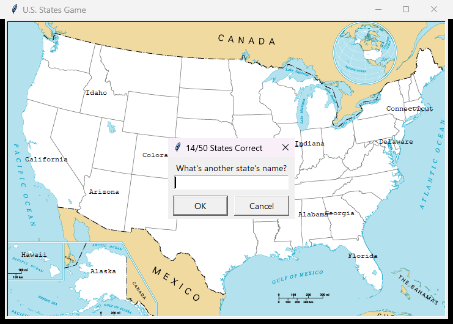

# U.S. States Game

A quiz game from Udemy's *100 Days of Code: The Complete Python Pro Bootcamp* (day 25): a Turtle window shows a blank map of the United States, you type state names, and every correct guess appears on the map. When you leave, the states you missed are saved to `states_to_learn.csv`.




This is a solution for course participants to compare with their own: the code keeps the assignment's names (`screen`, `guessed_states`, `missing_states`, `get_mouse_click_coor`, `states_to_learn.csv`). It reads the CSV with the standard library, so the game has no runtime dependencies. The wiki has the same instructions in English, Danish and Bahasa Malaysia.

## Requirements

- Python 3.13 or newer, with `tkinter` (Turtle needs it; the python.org installers and the Windows Store build include it)
- `git`
- Optional: [Doxygen](https://www.doxygen.nl/) to build the source documentation

The game has no runtime dependencies. `pytest` is installed only for development.

## Set up

Create a local virtual environment named `.venv` in the project folder, upgrade `pip` and install the project with its test tool.

### Windows powershell

```powershell
git clone https://git.tirsystem.com/Tirsvad-Udemy-100-days-of-code/025-us-states-game.git
cd 025-us-states-game
python -m venv .venv
.\.venv\Scripts\Activate.ps1
python -m pip install --upgrade pip
python -m pip install -e ".[dev]"
```

If PowerShell refuses to run the activation script, run `Set-ExecutionPolicy -Scope CurrentUser RemoteSigned` once.

### Linux debian

```bash
sudo apt install python3 python3-venv python3-tk git
git clone https://git.tirsystem.com/Tirsvad-Udemy-100-days-of-code/025-us-states-game.git
cd 025-us-states-game
python3 -m venv .venv
source .venv/bin/activate
python -m pip install --upgrade pip
python -m pip install -e ".[dev]"
```

### MacOS

```bash
git clone https://git.tirsystem.com/Tirsvad-Udemy-100-days-of-code/025-us-states-game.git
cd 025-us-states-game
python3 -m venv .venv
source .venv/bin/activate
python -m pip install --upgrade pip
python -m pip install -e ".[dev]"
```

## Run

With the virtual environment active:

```bash
python -m us_states_game
```

Type a state name in the prompt; case does not matter. The title of the prompt shows how many states you have named. Type `exit` (or press Cancel) to quit; the states you did not name are written to `states_to_learn.csv` in the current folder.

To print the coordinates of every mouse click on the map (lecture 1), add `--show-coordinates`:

```bash
python -m us_states_game --show-coordinates
```

The game can also be started with `python src/us_states_game/main.py`.

## Run the tests

```bash
python -m pytest
```

The tests need no display.

## Continuous integration

`.gitea/workflows/run-tests.yml` runs on every push to `main` and on every pull request: it sets up Python 3.13, installs the project with `python -m pip install -e ".[dev]"`, then runs `ruff`, `mypy`, `yamllint` and `python -m pytest`.

## Build the source documentation

The source uses Doxygen comments. With Doxygen installed:

```bash
doxygen Doxyfile
```

Open `docs/build/doxygen/index.html` in a browser.

## Project layout

| Path | What it is |
| --- | --- |
| `src/us_states_game/` | The game package: `constants.py`, `states.py` (rules), `storage.py` (CSV), `game.py` (guess loop), `turtle_screen.py` (Turtle), `main.py` (entry point) |
| `src/us_states_game/data/` | `50_states.csv` and `blank_states_img.gif` from the course |
| `tests/` | pytest tests; they need no display |
| `wiki/` | The wiki pages in English (`*.md`), Danish (`*.da.md`) and Bahasa Malaysia (`*.ms.md`) |
| `docs/images/` | Screenshots used by the README and the wiki |
| `docs/` | Project documents: business case, plan, milestones, review records |
| `Doxyfile` | Doxygen configuration |
| `pyproject.toml` | Project configuration |
| `.gitea/workflows/run-tests.yml` | Continuous integration |

## License

GNU Affero General Public License v3.0. See [LICENSE](LICENSE).

## Links

- [Repository](https://git.tirsystem.com/Tirsvad-Udemy-100-days-of-code/025-us-states-game)
- [Issue tracker](https://git.tirsystem.com/Tirsvad-Udemy-100-days-of-code/025-us-states-game/issues)
- [Wiki](https://git.tirsystem.com/Tirsvad-Udemy-100-days-of-code/025-us-states-game/wiki)

## Appendix: Project documents

| Document | What it tells you |
| --- | --- |
| [Business Case](docs/business-case.md) | Why the project exists, its scope and success criteria |
| [Stakeholder Analysis](docs/stakeholder-analysis.md) | Who is involved |
| [Project Plan](docs/project-plan.md) | The gateways and their schedule |
| [Milestones](docs/milestones/) | One document per gateway: Go/No-Go criteria and tasks |
| [Artifact registry](docs/artifact-registry.md) | Where each document type lives |
