# Project Plan

## Metadata
| Key | Value |
| --- | --- |
| ID | PP-001 |
| CrossReference | [BC-001], [SA-001], [MIL-001], [MIL-002], [MIL-003], [MIL-004] |
| Language | en |
| Domain | it |

## Version History
| Date | Status | Author | Reviewer | Change | Commit |
| --- | --- | --- | --- | --- | --- |
| 2026-10-13 | Accepted | Claude (AI) for S01 | S01 | Initial version; accepted by S01 in chat as part of the plan | [b113e6e] |

---

## Purpose

Schedule the four phases of the U.S. States Game over the one-working-day duration constraint of [BC-001], and name who owns them ([SA-001]).

## Planning Assumptions

- The work starts 2026-10-13 and ends the same day, per the Business Case constraint.
- One phase is one pull request; phases run strictly in sequence.
- S01 is owner and reviewer of every phase; reviews in autonomous mode are recorded as not independent.

## Gateway Schedule

| Gateway | Document | Window | Decision date | Owner | Stories | Main deliverable | Milestone |
| --- | --- | --- | --- | --- | --- | --- | --- |
| Baseline and repository setup | [MIL-001] | 2026-10-13 | 2026-10-13 | S01 | | Tooling, layout, assets, CI, repository surface | |
| Game core logic | [MIL-002] | 2026-10-13 | 2026-10-13 | S01 | | Tested, display-free game rules and ADR | |
| Turtle game and entry point | [MIL-003] | 2026-10-13 | 2026-10-13 | S01 | | Playable game | |
| Documentation, screenshots and wiki | [MIL-004] | 2026-10-13 | 2026-10-13 | S01 | | README, Doxygen, wiki in en/da/ms | |

```plantuml
@startgantt
Project starts 2026-10-13
[Baseline] starts 2026-10-13 and ends 2026-10-13
[Game core] starts 2026-10-13 and ends 2026-10-13
[Turtle game] starts 2026-10-13 and ends 2026-10-13
[Documentation] starts 2026-10-13 and ends 2026-10-13
[Baseline Go/No-Go] happens 2026-10-13
[Documentation Go/No-Go] happens 2026-10-13
@endgantt
```



## Scope Coverage

| Business Case scope item | Gateway |
| --- | --- |
| Game per the three lectures | MIL-002, MIL-003 |
| Python 3.13+, venv, pyproject, constants, layout, .gitignore | MIL-001 |
| pytest tests, CI | MIL-001, MIL-002, MIL-003 |
| Doxygen comments and Doxyfile | MIL-001, MIL-004 |
| README and wiki with screenshots | MIL-001, MIL-004 |
| Repository description and topics | MIL-001 |

## Dependencies

```
MIL-001 -> MIL-002 -> MIL-003 -> MIL-004
```

A No-Go stops later phases until its criteria are met; all dates shift together.

## Plan Risks

| Risk | Impact | Mitigation |
| --- | --- | --- |
| Screenshots cannot be captured in this environment | MIL-004 incomplete | Stop and report; the rest of the plan is unaffected |
| Git host rejects the token or the wiki push | Surface and wiki unpublished | Stop and report; content stays in the repository |

## Open Issues

- The prompt names the repository `https://git.tirsystem.com/Tirsvad-Udemy-100_days_of_code` while `origin` is `Tirsvad-Udemy-100-days-of-code/025-us-states-game`. The plan uses `origin`.
- The power and interest of S02 and S03 were set by the plan author; S01 may amend.

---

[BC-001]: ./business-case.md
[SA-001]: ./stakeholder-analysis.md
[MIL-001]: ./milestones/mil-001-baseline-setup.md
[MIL-002]: ./milestones/mil-002-game-core.md
[MIL-003]: ./milestones/mil-003-turtle-game.md
[MIL-004]: ./milestones/mil-004-docs-release.md
[b113e6e]: https://git.tirsystem.com/Tirsvad-Udemy-100-days-of-code/025-us-states-game/commit/b113e6eacd12bb08045ecf6f7822837626a7b1f7
