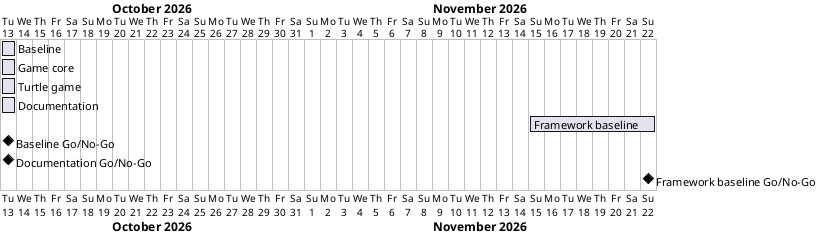

# Project Plan

## Metadata
| Key | Value |
| --- | --- |
| ID | PP-001 |
| CrossReference | [BC-001], [SA-001], [MIL-001], [MIL-002], [MIL-003], [MIL-004], [MIL-005] |
| Language | en |
| Domain | education |

## Version History
| Date | Status | Author | Reviewer | Change | Commit |
| --- | --- | --- | --- | --- | --- |
| 2026-10-13 | Deprecated | Claude (AI) for S01 | S01 | Initial version; accepted by S01 in chat as part of the plan | [b113e6e] |
| 2026-11-15 | Accepted | Jens Tirsvad Nielsen | AI as stand-in for S01 | Added the baseline gateway MIL-005, its schedule row, scope coverage, dependency, risk and Gantt entries, the No-Go rule and an open issue; linked the git host milestones of MIL-001 to MIL-004; set the domain to education; reviewed in autonomous mode, not independent | [a579509] |

---

## Purpose

Schedule the four phases of the U.S. States Game over the one-working-day duration constraint of [BC-001], and name who owns them ([SA-001]). A fifth gateway, [MIL-005], was added on 2026-11-15 to bring the finished project to the baseline of the framework; it runs from 2026-11-15 to 2026-11-22.

## Planning Assumptions

- The work starts 2026-10-13 and ends the same day, per the Business Case constraint.
- One phase is one pull request; phases run strictly in sequence.
- S01 is owner and reviewer of every phase; reviews in autonomous mode are recorded as not independent.
- The baseline gateway [MIL-005] starts 2026-11-15 and ends by 2026-11-22, one week (source: [BC-001], Assumptions). It is the only gateway outside the one working day of the first four, because of the agreed minimum quality baseline of the framework.
- For [MIL-005] S01 has authorised the assistant to commit, push, open the pull request and merge it, and the review is done by an AI stand-in for S01 (source: [BC-001], Constraints; [SA-001], Conflicting Interests and Mitigations).

## Gateway Schedule

| Gateway | Document | Window | Decision date | Owner | Stories | Main deliverable | Milestone |
| --- | --- | --- | --- | --- | --- | --- | --- |
| Baseline and repository setup | [MIL-001] | 2026-10-13 | 2026-10-13 | S01 | | Tooling, layout, assets, CI, repository surface | [Milestone 128][MS-128] |
| Game core logic | [MIL-002] | 2026-10-13 | 2026-10-13 | S01 | | Tested, display-free game rules and ADR | [Milestone 129][MS-129] |
| Turtle game and entry point | [MIL-003] | 2026-10-13 | 2026-10-13 | S01 | | Playable game | [Milestone 130][MS-130] |
| Documentation, screenshots and wiki | [MIL-004] | 2026-10-13 | 2026-10-13 | S01 | | README, Doxygen, wiki in en/da/ms | [Milestone 131][MS-131] |
| Framework baseline | [MIL-005] | 2026-11-15 to 2026-11-22 | 2026-11-22 | S01 | none | The framework release, the wiki in `docs/wiki/`, the README in the framework template, the licence metadata, the traceability matrix and the review records | [Milestone 535][MS-535] |



## Scope Coverage

| Business Case scope item | Gateway |
| --- | --- |
| Game per the three lectures | MIL-002, MIL-003 |
| Python 3.13+, venv, pyproject, constants, layout, .gitignore | MIL-001 |
| pytest tests, CI | MIL-001, MIL-002, MIL-003 |
| Doxygen comments and Doxyfile | MIL-001, MIL-004 |
| README and wiki with screenshots | MIL-001, MIL-004 |
| Repository description and topics | MIL-001 |
| The baseline: framework release, wiki location, README template, licence metadata, traceability matrix, review records | MIL-005 |

## Dependencies

```
MIL-001 -> MIL-002 -> MIL-003 -> MIL-004 -> MIL-005
```

A No-Go stops later phases until its criteria are met; all dates shift together. A No-Go on [MIL-005] leaves the game and the earlier gateways as they are; S01 decides the new date.

## Plan Risks

| Risk | Impact | Mitigation |
| --- | --- | --- |
| Screenshots cannot be captured in this environment | MIL-004 incomplete | Stop and report; the rest of the plan is unaffected |
| Git host rejects the token or the wiki push | Surface and wiki unpublished | Stop and report; content stays in the repository |
| A continuous integration (CI) check fails on the pull request of [MIL-005] | The merge is delayed past 2026-11-22 | The failure is fixed on the same branch and the checks run again; after three failed rounds on one cause the work stops and S01 decides (trace: success criterion 7 of [BC-001]) |

## Open Issues

- The prompt names the repository `https://git.tirsystem.com/Tirsvad-Udemy-100_days_of_code` while `origin` is `Tirsvad-Udemy-100-days-of-code/025-us-states-game`. The plan uses `origin`.
- The power and interest of S02 and S03 were set by the plan author; S01 may amend.
- Framework baseline (closed in [MIL-005]): the wiki pages moved from `wiki/` to `docs/wiki/`, the location the framework requires, and the Danish and Malay pages are named `Home-da` and `Home-ms`. [MIL-004] (task 4 and 5) still says `wiki/`, as it was accepted. The older wiki pages named `Home.da`, `Home.ms` and the like exist on the git host and are not deleted by this project. Every document with a `Domain` row now has the domain `education`.

---

[BC-001]: ./business-case.md
[SA-001]: ./stakeholder-analysis.md
[MIL-001]: ./milestones/mil-001-baseline-setup.md
[MIL-002]: ./milestones/mil-002-game-core.md
[MIL-003]: ./milestones/mil-003-turtle-game.md
[MIL-004]: ./milestones/mil-004-docs-release.md
[b113e6e]: https://git.tirsystem.com/Tirsvad-Udemy-100-days-of-code/025-us-states-game/commit/b113e6eacd12bb08045ecf6f7822837626a7b1f7
[MIL-005]: ./milestones/mil-005-framework-baseline.md
[MS-128]: https://git.tirsystem.com/Tirsvad-Udemy-100-days-of-code/025-us-states-game/milestone/128
[MS-129]: https://git.tirsystem.com/Tirsvad-Udemy-100-days-of-code/025-us-states-game/milestone/129
[MS-130]: https://git.tirsystem.com/Tirsvad-Udemy-100-days-of-code/025-us-states-game/milestone/130
[MS-131]: https://git.tirsystem.com/Tirsvad-Udemy-100-days-of-code/025-us-states-game/milestone/131
[MS-535]: https://git.tirsystem.com/Tirsvad-Udemy-100-days-of-code/025-us-states-game/milestone/535
[a579509]: https://git.tirsystem.com/Tirsvad-Udemy-100-days-of-code/025-us-states-game/commit/a5795093e1d293da9d29fced5cb24621b0a4c5bd
